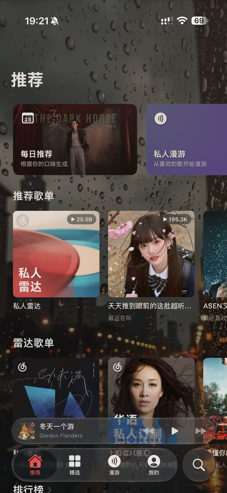
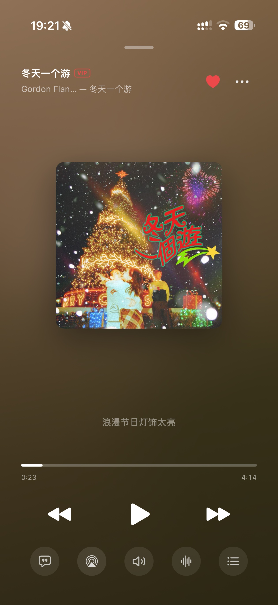
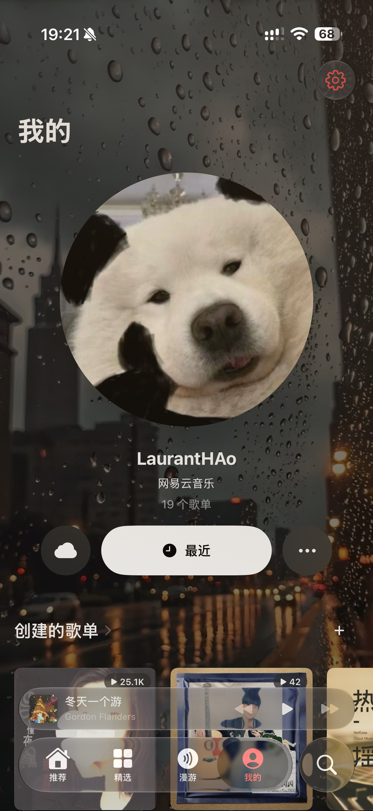
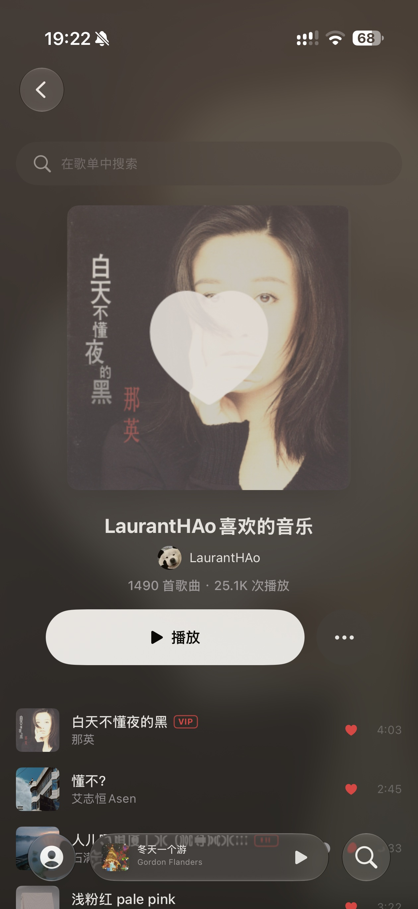
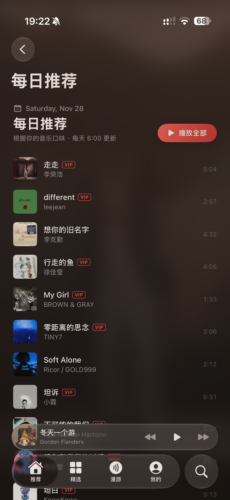

# HAo Music

一款干净、快速的 iOS 音乐应用。网易云音乐、QQ 音乐、酷狗、酷我多源听歌，高音质自动降档，灰歌自动找可播音源。

## 截图

| 首页 | 播放器 | 我的 | 喜欢的音乐 | 每日推荐 |
|---|---|---|---|---|
|  |  |  |  |  |

## 功能

- **多源听歌**：网易云音乐、QQ 音乐、酷狗音乐、酷我音乐，搜歌、播歌、看歌单、看排行。
- **合并搜索**：网易与 QQ 并行搜，结果去重，网易优先。
- **高音质**：多档音质可选，播不了自动往下降，只报实测档位，不谎报。
- **灰歌能播**：灰歌、VIP 歌自动匹配可播音源，多源并行找，最快的先出声。
- **歌词**：点封面看歌词，点歌词行跳转。
- **歌单与收藏**：创建歌单、收藏专辑与歌手、每日推荐、最近播放、我喜欢的音乐。
- **下载**：整张专辑、整个歌单、单曲都能离线下载。
- **电台**：FM 漫游，随便听听。
- **登录**：网易云、QQ 扫码登录，会话存钥匙串；登录后高档位按账号给。
- **均衡器、睡眠定时**：都在播放器里。
- **在线更新**：设置里检查更新，有新版直接下载安装。

## 安装

从 [Releases](https://github.com/lauranthao/HAoMusic/releases) 下载最新版 `HAoMusic.ipa`，用 TrollStore 或 LCSign 安装。

要求：iOS 16.0+。

## 更新日志

- **0.1.3 build 16（2026-11-27）**：下载改走播放地址（QQ 直链 → 网易音质 → 标准 → 解锁竞速，第一个完整地址获胜）；在线更新改按版本与构建号比较。
- **0.1.3 build 15（2026-11-27）**：首页各区块按统一标准对齐。
- **0.1.3 build 14（2026-11-27）**：本地音乐整个删除。
- **0.1.3 build 10（2026-11-27）**：动态封面主题、排行榜、热门歌单。
- 更早的版本见 git 历史。

当前版本：**0.1.3 build 16**。

## 免责声明

- HAo Music 仅供个人学习、研究与交流使用。
- 本应用不托管、不拥有任何音乐版权。歌曲、歌词、封面、评论等内容均来自各音乐平台的公开接口，由各平台实时提供。
- 全部音乐内容与商标的权利归原平台与原权利人所有。请支持正版音乐，通过平台会员获取相应权益。
- 完整条款见应用内「设置 → 关于 → 查看完整免责声明」；首次启动时也会请你阅读并确认。

## 从源码构建

需要 Xcode 26+、macOS。打开 `HAoMusic.xcodeproj`，选 HAoMusic scheme，Run。首次构建需在 Xcode 里选自己的 Team。

## License

AGPL-3.0
